# Movie Ticket Booking Backend

An API for browsing movies, booking seats and managing payments. Administrators can manage users, movies, theatres, shows and bookings.

## Technologies

- Java 25
- Spring Boot, Spring Data JPA and Spring Security
- MySQL
- Maven
- JWT, Lombok and ModelMapper

## ERD



[PNG](docs/erd.png)

## Setup

Create the database, tables and sample data:

```bash
mysql -u root -p < database/setup.sql
```

The included `.env` file uses these database settings:

```properties
DB_URL=jdbc:mysql://localhost:3306/movie_booking?connectionTimeZone=Asia/Colombo
DB_USERNAME=movie_booking
DB_PASSWORD=userpassword123
```

In IntelliJ IDEA, select `.env` in the run configuration's environment variables settings.

## Run

```bash
./scripts/run.sh
```

Base URL: `http://localhost:8080/moviebackend/api`

The database script adds sample movies, theatres, shows and these accounts:

| Role | Email | Password |
| --- | --- | --- |
| ADMIN | `admin@movies.lk` | `AdminDemo@123` |
| CUSTOMER | `nimal@movies.lk` | `CustomerDemo@123` |

## Authentication

Register with `POST /auth/signup`:

```json
{"name":"Amali Jayasinghe","email":"amali@movies.lk","password":"AmaliPassword@123"}
```

Sign in with `POST /auth/signin`:

```json
{"email":"nimal@movies.lk","password":"CustomerDemo@123"}
```

Sign-in returns a JWT in `token`. Use it for other requests:

```text
Authorization: Bearer <token>
```

New accounts have the CUSTOMER role.

## API endpoints

Paths below are relative to the base URL. All routes except sign-up and sign-in require authentication.

| Method | Path | Access |
| --- | --- | --- |
| POST | `/auth/signup` | Public |
| POST | `/auth/signin` | Public |
| GET | `/users` | ADMIN |
| GET | `/users/{id}` | ADMIN |
| PUT | `/users/{id}` | ADMIN |
| DELETE | `/users/{id}` | ADMIN |
| POST | `/movies` | ADMIN |
| GET | `/movies` | ADMIN, CUSTOMER |
| GET | `/movies/{id}` | ADMIN, CUSTOMER |
| PUT | `/movies/{id}` | ADMIN |
| DELETE | `/movies/{id}` | ADMIN |
| POST | `/theatres` | ADMIN |
| GET | `/theatres` | ADMIN, CUSTOMER |
| GET | `/theatres/{id}` | ADMIN, CUSTOMER |
| PUT | `/theatres/{id}` | ADMIN |
| DELETE | `/theatres/{id}` | ADMIN |
| POST | `/shows` | ADMIN |
| GET | `/shows` | ADMIN, CUSTOMER |
| GET | `/shows/movie/{movieId}` | ADMIN, CUSTOMER |
| GET | `/shows/{id}` | ADMIN, CUSTOMER |
| GET | `/shows/{id}/seats` | ADMIN, CUSTOMER |
| PUT | `/shows/{id}` | ADMIN |
| DELETE | `/shows/{id}` | ADMIN |
| POST | `/bookings` | CUSTOMER |
| GET | `/bookings` | ADMIN |
| GET | `/bookings/my-bookings` | Current user |
| GET | `/bookings/{id}` | Owner, ADMIN |
| PUT | `/bookings/{id}/cancel` | Owner, ADMIN |
| PUT | `/bookings/{id}/status` | ADMIN |
| POST | `/payments` | CUSTOMER |
| GET | `/payments` | ADMIN |
| GET | `/payments/{id}` | Owner, ADMIN |
| PUT | `/payments/{id}/process` | CUSTOMER |
| GET | `/payments/{id}/status` | Owner, ADMIN |

## Sample requests

Create a movie with `POST /movies`:

```json
{
  "title": "Colombo Sihinaya",
  "description": "A young musician follows his dream in Colombo.",
  "duration": 120,
  "language": "Sinhala",
  "genre": "Drama",
  "releaseDate": "2026-10-12",
  "status": "NOW_SHOWING"
}
```

Create a show with `POST /shows`. Use valid movie and theatre IDs and a future date:

```json
{
  "movieId": "M-DEMO-1",
  "theatreId": "T-DEMO-1",
  "showDate": "2026-10-20",
  "showTime": "18:30",
  "ticketPrice": 1500.00,
  "status": "SCHEDULED"
}
```

Book seats with `POST /bookings`:

```json
{"showId":"S-DEMO-1","seatNumbers":["A1","A2"],"numberOfTickets":2}
```

The total is calculated from the ticket price and selected seats. Amounts are in LKR. Seats are numbered `A1`–`A10`, `B1`–`B10`, and so on.

Create a payment with `POST /payments`, using the returned booking ID:

```json
{"bookingId":"B-replace-with-booking-id","paymentMethod":"CARD"}
```

Process it with `PUT /payments/{id}/process`:

```json
{"status":"COMPLETED"}
```

Completed payments confirm bookings. Payment processing is simulated; no money is transferred.

Cancel a booking with `PUT /bookings/{id}/cancel`. No request body is needed.
